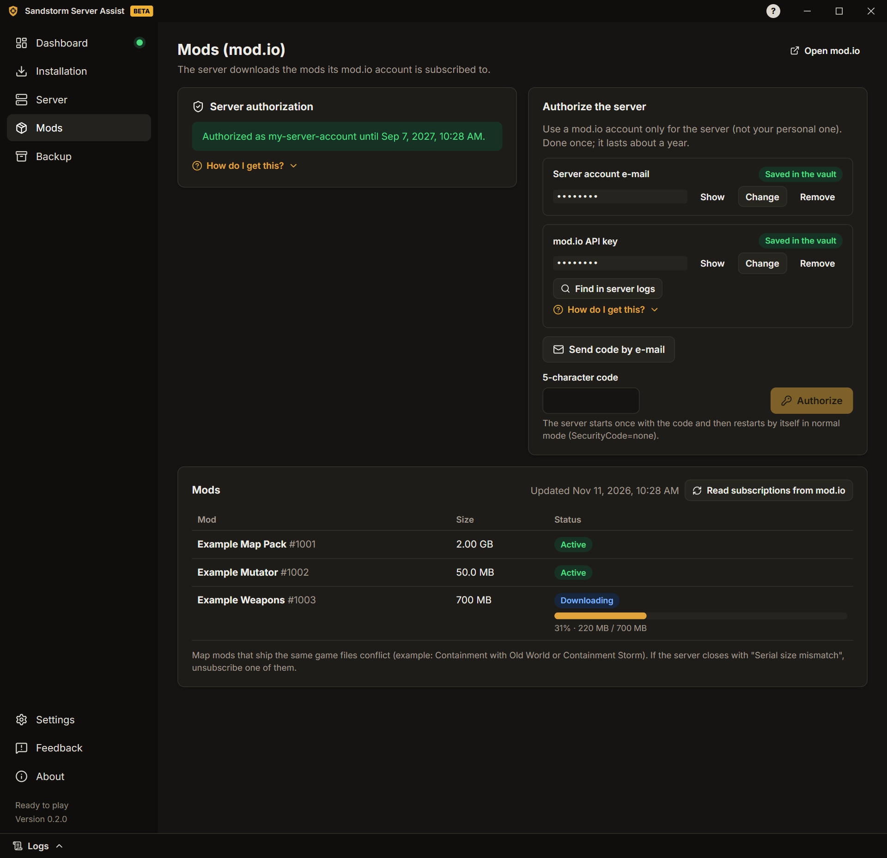

# User guide

**English** · [Português](pt-PT/GUIDE.md) · [Español](es-ES/GUIDE.md) · [Русский](ru/GUIDE.md) · [Українська](uk/GUIDE.md)

This guide takes you from zero to a running Insurgency: Sandstorm server with mods. Every screen of the app also has
short hints and "How to get it?" guides.

## 1. Install the app

1. Download the installer (`…-windows-setup.exe`) from the
   [Releases page](https://github.com/felipesulzbach/sandstorm-server-assist/releases/latest).
2. Run it. It installs for your Windows user and does not ask for administrator rights. If SmartScreen warns you,
   click **More info** › **Run anyway**.
3. Open the app, choose your language and accept the terms of use and the privacy notice.

The app checks for new versions by itself and installs only updates signed by the project.

## 2. Install the server

1. Open **Installation** and choose the **Server folder**. It needs about 25 GB free, plus the mods. Avoid system
   folders such as `C:\Program Files`.
2. Click **Download SteamCMD**. The app checks Valve's digital signature before running it. Once it is there, the button becomes **Check SteamCMD**: SteamCMD updates itself every time the app uses it.
3. Click **Install server** and follow the progress. Later, **Check for updates** updates it, and **Verify files**
   repairs a broken install.

**Already have a server?** Choose its folder instead. The app reads the settings it used last time (from its log
and config files) and fills the fields. When a value in the app differs from the server, it asks which one to keep.

**Starting over?** If you moved or deleted the server folder, or chose a new one, the app offers **Start from
scratch** to clear the previous server's settings (you choose whether the passwords go too).

## 3. Configure the server

Open **Server**. The tabs are:

- **General:** server name, max players and ports.
- **Maps:** start map, mod map (the map the server opens after loading the mods), map cycle, day or night, and
  mutators (the app finds the mutators of your installed mods).
  If the server refuses a mutator, the Dashboard and this list say which one.
  Game mutators that change the same setting (such as All You Can Eat and Strapped, both starting supply
  points) cancel each other, so while one is on the others are turned off.
  The map rotation is shown by map: **Add map** picks a game or mod map and its scenarios, each map has
  buttons to add a scenario, move it up or down and remove it, and each scenario is by day or by night (tick
  both to play a map by day and again by night). The
  MapCycle.txt file stays one scenario per line; **Edit as text** is still there for anything else.
  A new server starts with the default rotation of the game maps, in the mode of the start map; **Use the default
  rotation** fills it again at any time. Only mods of the server's mod.io account are listed.
- **Game rules:** bots and difficulty, timers, friendly fire, chat and voice, votes and more. Leave it off to keep
  the files as they are.
  If the server already sets rules, the tab offers **Use the server rules**.
- **Administrators:** the SteamID64 of each admin (the guide shows how to find it).
- **Passwords & tokens:** join password, RCON password, Steam game server token (GSLT) and GameStats token. They are
  kept in a vault encrypted by Windows, never in the server files.
- **Network:** ports, the IP players use, the Firewall rule and the port diagnosis (section 5).
- **Messages:** message of the day (loading screen) and chat messages when a player joins or leaves.
- **Automation:** scheduled messages, daily restart, restart after a crash and Discord notices.

Click **Save** after changing a tab.

## 4. Add mods

The server downloads the mods its mod.io account is subscribed to.

1. Open **Mods**. Use a mod.io account only for the server, not your personal one. Type its e-mail and click **Send code
   by e-mail**. The app uses the game's own mod.io key, read from the installed server; no key of your own is needed.
2. Type the 5-character code and click **Authorize**. The server is authorized once; the app returns to normal mode
   by itself.
3. Subscribe to mods on the [mod.io website](https://mod.io/g/insurgencysandstorm) with that account. The list shows
   each mod and its download when the server starts.
   Mods not downloaded yet show above the list: **Download now** starts the server (or restarts it, after asking)
   so it downloads them.

To start on a mod map, choose it in **Server › Maps** (**Mod map name** and **Mod map scenario**).

A mod looks broken or you want a fresh copy? Click the bin next to it. **Delete and download again** stops and
starts the server for you; **Only delete** (server stopped) leaves the download for the next start.

## 5. Open the ports

Players on the internet reach your server through two **UDP** ports: the **game port** and the **query port**
(shown in **Server › Network**).

1. In your router page, forward both ports (UDP) to this PC. If you play through a VPN program instead, skip this
   step and share the VPN address.
2. In **Server › Network**, click **Create the firewall rule**. Windows asks for administrator confirmation.
3. **Never forward the RCON port.** It must stay closed to the internet.

Then click **Diagnose ports**, preferably with the server running. The app checks from this PC:

- whether the server answers on the query port;
- the Windows Firewall rules;
- your router's port forwards (if the router allows UPnP);
- your public IP, and whether your provider uses CGNAT (then port forwarding cannot work);
- whether the server answers through your public IP, and whether Steam lists it.

### Test with a friend

A PC cannot prove that its own ports are open from the internet. With the server running, ask a friend on another
network to:

1. Open Steam › **View** › **Game Servers** › **Favorites**.
2. Click **Add a server** (+), type `your-public-IP:query-port` and click **Find games at this address**.
3. If your server shows up with its name and map, the ports are open.

Tips: do not test from a PC on your own network (most routers block it); mobile data counts as another network;
websites that "check ports" usually test only TCP, and the game uses UDP.

## 6. Start the server

1. Open the **Dashboard** and click **Start server**.
2. Follow the phases: process started, mod.io connected, mods activated, map loaded, ready to play.
3. Share the join command shown on the Dashboard with your players.

The game server keeps running if you close the app. When you open the app again, it finds the server and follows it.

While it runs you can **change the map**, open the **players panel** (kick, ban, message everyone) and read the
**Logs** (the drawer at the bottom; passwords and tokens are masked).

## 7. Backup

Open **Backup** to create one file, protected by a password, with your settings, secrets and server config files.
Use it to move the server to another PC: **Open backup** there, type the password and choose the server folder.
Without the password the backup cannot be opened.

## 8. Problems and feedback

- Every known error shows **what happened**, the **possible cause** and **how to fix it**.
- Open the **Logs** drawer to see what the server is doing.
- **Mods › Mods with problems** lists mods that ship the same game files in different versions, and finds the mod
  of a crash message: paste the error a player got (for example "Serial size mismatch") and the app names the mod.

To report a problem or suggest an improvement, open **Feedback**:

1. Choose **Report a problem** or **Suggest an improvement**.
2. Optionally type a title and a description, keep **Include the app log** ticked and add a screenshot (up to 5 MB).
3. Click **Prepare and open GitHub**. The app saves a `.zip` on your PC and opens the GitHub form already filled in.
4. Drag the `.zip` into the form and click **Create**. You need a free GitHub account.

The app sends nothing by itself. In the log, passwords, tokens, IP addresses and SteamIDs are masked.
