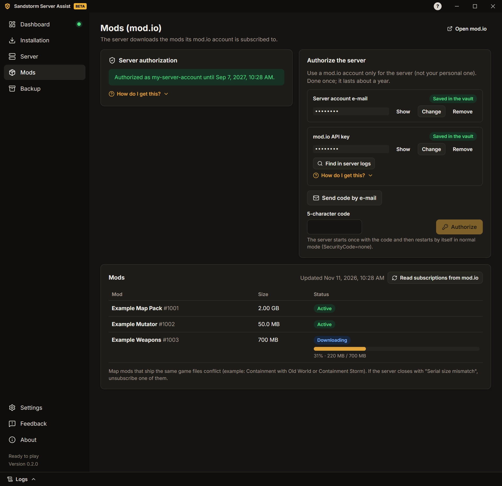

# Guía de uso

[English](../GUIDE.md) · [Português](../pt-PT/GUIDE.md) · **Español** · [Русский](../ru/GUIDE.md) · [Українська](../uk/GUIDE.md)

> Traducción de la [guía en inglés](../GUIDE.md). Si hay diferencias, vale la versión en inglés.

Esta guía te lleva desde cero hasta un servidor de Insurgency: Sandstorm con mods en marcha. Cada pantalla de la app
también tiene consejos cortos y guías "¿Cómo conseguirlo?".

## 1. Instalar la app

1. Descarga el instalador (`…-windows-setup.exe`) en la
   [página de versiones](https://github.com/felipesulzbach/sandstorm-server-assist/releases/latest).
2. Ejecútalo. Se instala para tu usuario de Windows y no pide administrador. Si SmartScreen avisa, pulsa
   **Más información** › **Ejecutar de todas formas**.
3. Abre la app, elige el idioma y acepta los términos de uso y el aviso de privacidad (**Aceptar y continuar**).

La app busca versiones nuevas sola y solo instala actualizaciones firmadas por el proyecto.

## 2. Instalar el servidor

1. Abre **Instalación** y elige la **Carpeta del servidor**. Necesita unos 25 GB libres, más los mods. Evita
   carpetas del sistema como `C:\Program Files`.
2. Pulsa **Descargar SteamCMD**. La app comprueba la firma digital de Valve antes de ejecutarlo. Una vez descargado, el botón pasa a ser **Comprobar SteamCMD**: SteamCMD se actualiza solo cada vez que la app lo usa.
3. Pulsa **Instalar servidor** y sigue el progreso. Más tarde, **Buscar actualizaciones** lo actualiza y
   **Verificar archivos** repara una instalación dañada.

**¿Ya tienes un servidor?** Elige su carpeta. La app lee la configuración que usó la última vez (de su registro y de
sus archivos de configuración) y rellena los campos. Cuando un valor de la app es distinto del servidor, pregunta
cuál mantener.

## 3. Configurar el servidor

Abre **Servidor**. Las pestañas son:

- **General:** nombre del servidor, máximo de jugadores y puertos.
- **Mapas:** mapa inicial, mapa del mod (el mapa que abre el servidor tras cargar los mods), rotación de mapas, día o
  noche y mutators (la app encuentra los mutators de tus mods instalados).
- **Reglas del juego:** bots y dificultad, tiempos, fuego amigo, chat y voz, votaciones y más. Déjalo desactivado
  para mantener los archivos como están.
- **Administradores:** el SteamID64 de cada administrador (la guía muestra cómo encontrarlo).
- **Contraseñas y tokens:** contraseña de entrada, contraseña RCON, token de servidor de juego de Steam (GSLT) y token
  de GameStats. Se guardan en una caja fuerte cifrada por Windows, nunca en los archivos del servidor.
- **Red:** puertos, la IP que usan los jugadores, la regla del firewall y el diagnóstico de puertos (sección 5).
- **Mensajes:** mensaje del día (pantalla de carga) y mensajes en el chat cuando un jugador entra o sale.
- **Automatización:** mensajes programados, reinicio diario, reinicio tras un cierre inesperado y avisos en Discord.

Pulsa **Guardar** después de cambiar una pestaña.

## 4. Añadir mods

El servidor descarga los mods a los que está suscrita su cuenta de mod.io.

1. Abre **Mods**. Usa una cuenta de mod.io solo para el servidor, no la personal. Escribe su correo y la clave de API
   de mod.io (**Buscar en los registros del servidor**, o crea una con la guía). Pulsa **Enviar código por correo**.
2. Escribe el código de 5 caracteres y pulsa **Autorizar**. El servidor se autoriza una vez; la app vuelve sola al
   modo normal.
3. Suscríbete a mods en la [web de mod.io](https://mod.io/g/insurgencysandstorm) con esa cuenta. La lista muestra cada
   mod y su descarga cuando el servidor arranca.
   Los mods aún no descargados aparecen encima de la lista: **Descargar ahora** arranca el servidor (o lo reinicia,
   tras preguntar) para descargarlos.

Para empezar en un mapa de mod, elígelo en **Servidor › Mapas** (**Nombre del mapa del mod** y
**Escenario del mapa del mod**).

¿Un mod parece dañado o quieres una copia nueva? Pulsa la papelera junto a él. **Borrar y descargar de nuevo**
detiene y arranca el servidor por ti; **Solo borrar** (servidor detenido) deja la descarga para el próximo arranque.

## 5. Abrir los puertos

Los jugadores de internet llegan a tu servidor por dos puertos **UDP**: el **puerto de juego** y el **puerto de
consulta** (se ven en **Servidor › Red**).

1. En la página de tu router, redirige los dos puertos (UDP) a este PC. Si juegas con un programa de VPN, sáltate este
   paso y comparte la dirección de la VPN.
2. En **Servidor › Red**, pulsa **Crear la regla del firewall**. Windows pide confirmación de administrador.
3. **Nunca redirijas el puerto RCON.** Tiene que estar cerrado a internet.

Después pulsa **Diagnosticar puertos**, mejor con el servidor en marcha. La app comprueba desde este PC:

- si el servidor responde en el puerto de consulta;
- las reglas del Firewall de Windows;
- las redirecciones de tu router (si el router permite UPnP);
- tu IP pública y si tu proveedor usa CGNAT (en ese caso la redirección de puertos no puede funcionar);
- si el servidor responde a través de tu IP pública y si Steam lo muestra.

### Probar con un amigo

Un PC no puede demostrar que sus propios puertos están abiertos a internet. Con el servidor en marcha, pide a un
amigo de otra red que:

1. Abra Steam › **Ver** › **Servidores de juego** › **Favoritos**.
2. Pulse **Añadir un servidor** (+), escriba `tu-IP-pública:puerto-de-consulta` y pulse
   **Buscar partidas en esta dirección**.
3. Si tu servidor aparece con su nombre y su mapa, los puertos están abiertos.

Consejos: no pruebes desde un PC de tu red (la mayoría de los routers lo bloquean); los datos móviles cuentan como
otra red; las webs que "comprueban puertos" suelen probar solo TCP, y el juego usa UDP.

## 6. Iniciar el servidor

1. Abre el **Panel** y pulsa **Iniciar servidor**.
2. Sigue las fases: proceso iniciado, mod.io conectado, mods activados, mapa cargado, listo para jugar.
3. Comparte con tus jugadores el comando para entrar que aparece en el Panel.

El servidor del juego sigue en marcha si cierras la app. Cuando vuelvas a abrirla, encuentra el servidor y lo sigue.

Con el servidor en marcha puedes **cambiar de mapa**, abrir el **panel de jugadores** (expulsar, banear, mensaje a
todos) y leer los **Registros** (el cajón de abajo; las contraseñas y los tokens se ocultan).

## 7. Copia de seguridad

Abre **Copia de seguridad** para crear un archivo, protegido con contraseña, con tus ajustes, tus secretos y los
archivos de configuración del servidor. Úsalo para llevar el servidor a otro PC: allí, **Abrir copia**, escribe la
contraseña y elige la carpeta del servidor. Sin la contraseña la copia no se puede abrir.

## 8. Problemas y comentarios

- Cada error conocido muestra **qué pasó**, la **posible causa** y **cómo arreglarlo**.
- Abre el cajón **Registros** para ver qué está haciendo el servidor.

Para informar de un problema o sugerir una mejora, abre **Comentarios**:

1. Elige **Informar de un problema** o **Sugerir una mejora**.
2. Si quieres, escribe un título y una descripción, deja marcado **Incluir el registro de la app** y añade una
   captura de pantalla (hasta 5 MB).
3. Pulsa **Preparar y abrir GitHub**. La app guarda un `.zip` en tu PC y abre el formulario de GitHub ya rellenado.
4. Arrastra el `.zip` al formulario y pulsa **Create**. Necesitas una cuenta gratuita de GitHub.

La app no envía nada por sí sola. En el registro, las contraseñas, los tokens, las direcciones IP y los SteamIDs se
ocultan.
