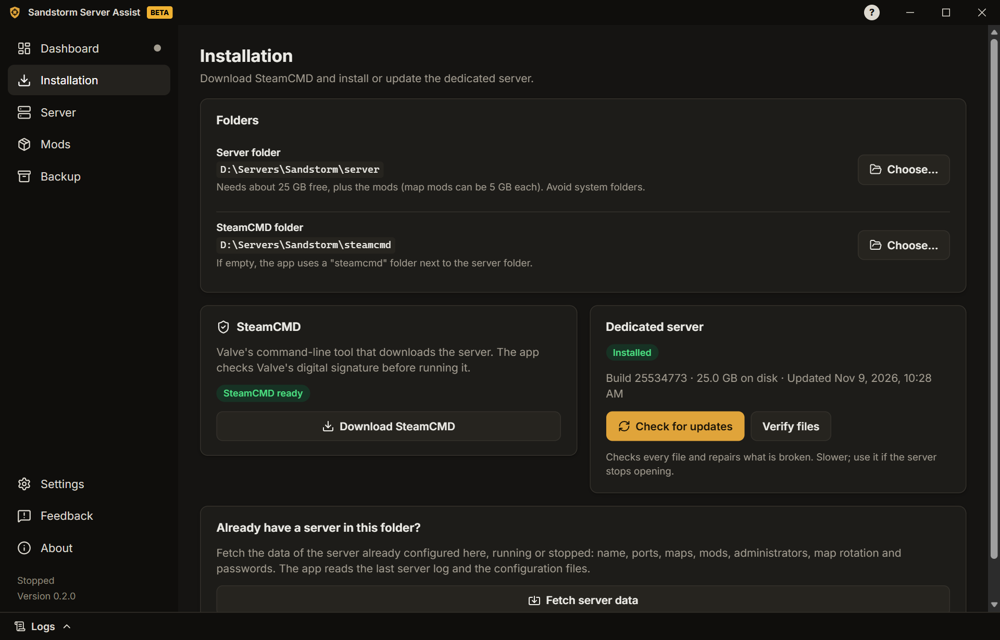
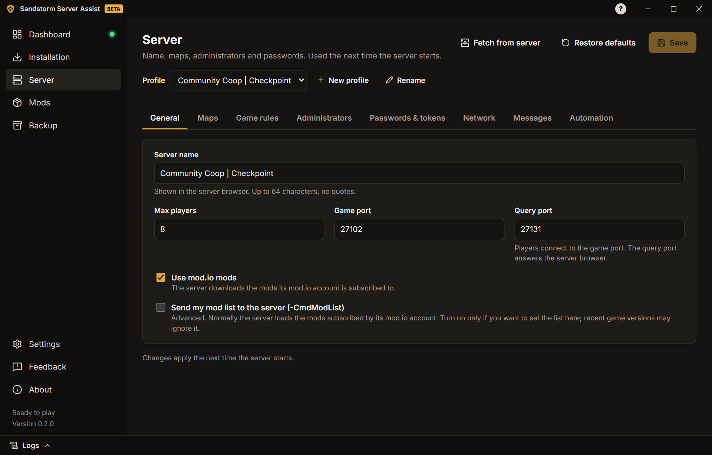
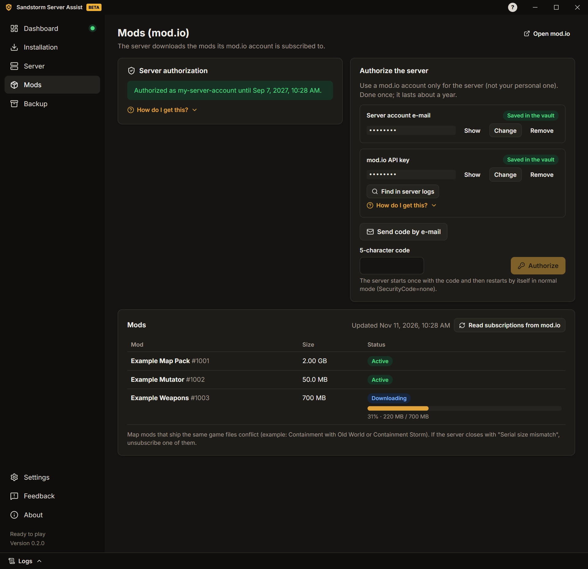
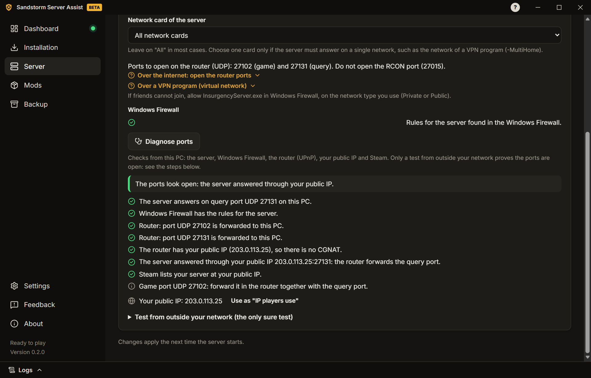
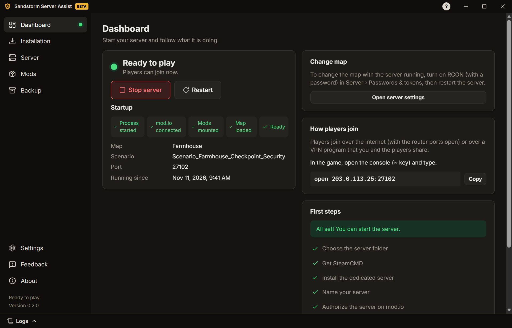
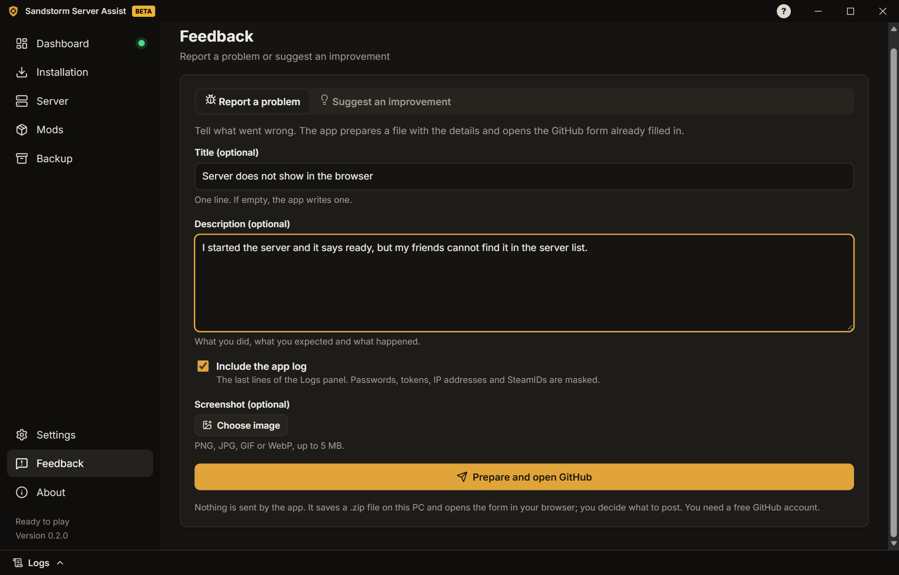

# Guia de utilização

[English](../GUIDE.md) · **Português** · [Español](../es-ES/GUIDE.md) · [Русский](../ru/GUIDE.md) · [Українська](../uk/GUIDE.md)

> Tradução do [guia em inglês](../GUIDE.md). Se houver diferenças, vale a versão em inglês.

Este guia leva-o do zero até um servidor de Insurgency: Sandstorm com mods a correr. Cada ecrã da app também tem
dicas curtas e guias "Como obter?".

## 1. Instalar a app

1. Transfira o instalador (`…-windows-setup.exe`) na
   [página de versões](https://github.com/felipesulzbach/sandstorm-server-assist/releases/latest).
2. Execute-o. Instala para o seu utilizador do Windows e não pede administrador. Se o SmartScreen avisar, clique em
   **Mais informações** › **Executar mesmo assim**.
3. Abra a app, escolha o idioma e aceite os termos de utilização e o aviso de privacidade (**Aceitar e continuar**).

A app procura versões novas sozinha e só instala atualizações assinadas pelo projeto.

## 2. Instalar o servidor

1. Abra **Instalação** e escolha a **Pasta do servidor**. Precisa de cerca de 25 GB livres, mais os mods. Evite
   pastas do sistema, como `C:\Program Files`.
2. Clique em **Transferir SteamCMD**. A app verifica a assinatura digital da Valve antes de o executar. Depois de transferido, o botão passa a **Verificar SteamCMD**: o SteamCMD atualiza-se sozinho sempre que a app o usa.
3. Clique em **Instalar servidor** e acompanhe o progresso. Mais tarde, **Procurar atualizações** atualiza-o e
   **Verificar ficheiros** repara uma instalação estragada.

**Já tem um servidor?** Escolha a pasta dele. A app lê as definições usadas da última vez (do registo e dos
ficheiros de configuração) e preenche os campos. Quando um valor da app é diferente do servidor, pergunta qual
manter.

**Vai recomeçar?** Se moveu ou apagou a pasta do servidor, ou escolheu uma nova, a app oferece **Começar do
zero** para limpar as definições do servidor anterior (escolhe se as palavras-passe também saem).

## 3. Configurar o servidor

Abra **Servidor**. Os separadores são:

- **Geral:** nome do servidor, máximo de jogadores e portas.
- **Mapas:** mapa inicial, mapa do mod (o mapa que o servidor abre depois de carregar os mods), rotação de mapas, dia
  ou noite e mutators (a app encontra os mutators dos mods instalados).
  Se o servidor recusar um mutator, o Painel e esta lista dizem qual.
  Mutators do jogo que mudam o mesmo ajuste (como All You Can Eat e Strapped, ambos nos pontos de
  abastecimento iniciais) anulam-se, por isso enquanto um estiver marcado os outros ficam desligados.
  A rotação de mapas aparece por mapa: **Adicionar mapa** escolhe um mapa do jogo ou de um mod e os
  cenários dele, cada mapa tem botões para adicionar um cenário, subir, descer e tirar, e cada cenário
  é de dia ou de noite (marque os dois para jogar o mapa de dia e depois de noite). O ficheiro
  MapCycle.txt continua com um cenário por linha; **Editar como texto**
  continua lá para o resto.
  Um servidor novo começa com a rotação padrão dos mapas do jogo, no modo do mapa inicial; **Usar a rotação
  padrão** volta a preenchê-la a qualquer momento. Só aparecem os mods da conta do mod.io do servidor.
- **Regras do jogo:** bots e dificuldade, tempos, fogo amigo, chat e voz, votações e mais. Deixe desligado para
  manter os ficheiros como estão.
  Se o servidor já define regras, a aba oferece **Usar as regras do servidor**.
- **Administradores:** o SteamID64 de cada administrador (o guia mostra como o encontrar).
- **Palavras-passe e tokens:** senha de entrada, senha RCON, token de servidor de jogo da Steam (GSLT) e token do
  GameStats. Ficam num cofre cifrado pelo Windows, nunca nos ficheiros do servidor.
- **Rede:** portas, o IP que os jogadores usam, a regra da firewall e o diagnóstico de portas (secção 5).
- **Mensagens:** mensagem do dia (ecrã de carregamento) e mensagens no chat quando um jogador entra ou sai.
- **Automação:** mensagens programadas, reinício diário, reinício depois de uma falha e avisos no Discord.

Clique em **Guardar** depois de mudar um separador.

## 4. Adicionar mods

O servidor transfere os mods subscritos pela conta do mod.io dele.

1. Abra **Mods**. Use uma conta do mod.io só para o servidor, não a sua pessoal. Escreva o e-mail dela e clique em
   **Enviar código por e-mail**. A app usa a chave do mod.io do próprio jogo, lida do servidor instalado; não precisa
   de uma chave sua.
2. Escreva o código de 5 caracteres e clique em **Autorizar**. O servidor é autorizado uma vez; a app volta sozinha
   ao modo normal.
3. Subscreva mods no [site do mod.io](https://mod.io/g/insurgencysandstorm) com essa conta. A lista mostra cada mod e
   o download dele quando o servidor inicia.
   Os mods ainda não transferidos aparecem acima da lista: **Transferir agora** arranca o servidor (ou reinicia-o,
   depois de perguntar) para os transferir.

Para começar num mapa de mod, escolha-o em **Servidor › Mapas** (**Nome do mapa do mod** e
**Cenário do mapa do mod**).

Um mod parece danificado ou quer uma cópia nova? Clique no caixote ao lado dele. **Apagar e transferir de novo**
para e arranca o servidor por si; **Só apagar** (servidor parado) deixa a transferência para o próximo arranque.

## 5. Abrir as portas

Os jogadores na internet chegam ao servidor por duas portas **UDP**: a **porta de jogo** e a **porta de consulta**
(mostradas em **Servidor › Rede**).

1. Na página do router, reencaminhe as duas portas (UDP) para este PC. Se joga por um programa de VPN, salte este
   passo e partilhe o endereço da VPN.
2. Em **Servidor › Rede**, clique em **Criar a regra da firewall**. O Windows pede a confirmação de administrador.
3. **Nunca reencaminhe a porta RCON.** Tem de ficar fechada para a internet.

Depois clique em **Diagnosticar portas**, de preferência com o servidor ligado. A app verifica a partir deste PC:

- se o servidor responde na porta de consulta;
- as regras da Firewall do Windows;
- os reencaminhamentos do router (se o router permitir UPnP);
- o seu IP público e se o fornecedor usa CGNAT (nesse caso o reencaminhamento de portas não funciona);
- se o servidor responde pelo seu IP público e se a Steam o lista.

### Testar com um amigo

Um PC não consegue provar que as próprias portas estão abertas para a internet. Com o servidor ligado, peça a um
amigo noutra rede que:

1. Abra a Steam › **Ver** › **Servidores de jogo** › **Favoritos**.
2. Clique em **Adicionar servidor** (+), escreva `seu-IP-público:porta-de-consulta` e clique em
   **Procurar jogos neste endereço**.
3. Se o servidor aparecer com o nome e o mapa, as portas estão abertas.

Dicas: não teste a partir de um PC da sua rede (a maioria dos routers bloqueia); os dados móveis contam como outra
rede; sites que "testam portas" normalmente testam só TCP, e o jogo usa UDP.

## 6. Iniciar o servidor

1. Abra o **Painel** e clique em **Iniciar servidor**.
2. Acompanhe as fases: processo iniciado, mod.io ligado, mods ativados, mapa carregado, pronto para jogar.
3. Partilhe com os jogadores o comando de entrada mostrado no Painel.

O servidor do jogo continua a correr se fechar a app. Quando abrir a app de novo, ela encontra o servidor e
acompanha-o.

Com o servidor ligado pode **trocar o mapa**, abrir o **painel de jogadores** (expulsar, banir, mensagem para todos)
e ler os **Registos** (a gaveta em baixo; senhas e tokens ficam mascarados).

## 7. Cópia de segurança

Abra **Cópia de segurança** para criar um ficheiro, protegido por palavra-passe, com as definições, os segredos e os
ficheiros de configuração do servidor. Use-o para levar o servidor para outro PC: lá, **Abrir cópia**, escreva a
palavra-passe e escolha a pasta do servidor. Sem a palavra-passe a cópia não abre.

## 8. Problemas e feedback

- Cada erro conhecido mostra **o que aconteceu**, a **possível causa** e **como resolver**.
- Abra a gaveta **Registos** para ver o que o servidor está a fazer.
- **Mods › Mods com problemas** mostra mods que trazem os mesmos ficheiros do jogo em versões diferentes e encontra
  o mod de uma mensagem de erro: cole o erro que um jogador recebeu (por exemplo "Serial size mismatch") e a app
  indica o mod.

Para relatar um problema ou sugerir uma melhoria, abra **Feedback**:

1. Escolha **Relatar um problema** ou **Sugerir uma melhoria**.
2. Se quiser, escreva um título e uma descrição, mantenha **Incluir o registo da app** marcado e junte uma captura de
   ecrã (até 5 MB).
3. Clique em **Preparar e abrir o GitHub**. A app guarda um `.zip` no PC e abre o formulário do GitHub já preenchido.
4. Arraste o `.zip` para o formulário e clique em **Create**. É preciso uma conta gratuita no GitHub.

A app não envia nada sozinha. No registo, senhas, tokens, endereços IP e SteamIDs ficam mascarados.
