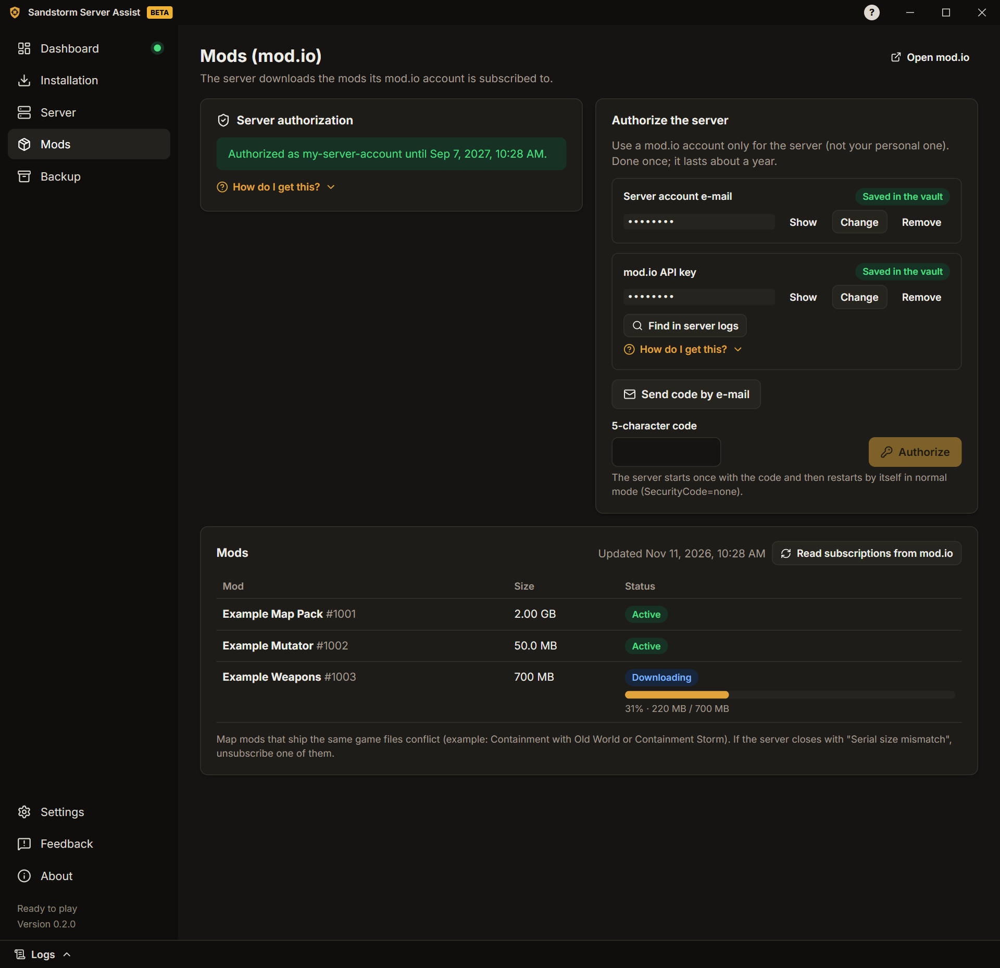

# Руководство пользователя

[English](../GUIDE.md) · [Português](../pt-PT/GUIDE.md) · [Español](../es-ES/GUIDE.md) · **Русский** · [Українська](../uk/GUIDE.md)

> Перевод [руководства на английском](../GUIDE.md). Если есть расхождения, верна английская версия.

Это руководство проведёт вас от нуля до работающего сервера Insurgency: Sandstorm с модами. На каждом экране
приложения тоже есть короткие подсказки и инструкции «Как получить?».

## 1. Установка приложения

1. Скачайте установщик (`…-windows-setup.exe`) на
   [странице релизов](https://github.com/felipesulzbach/sandstorm-server-assist/releases/latest).
2. Запустите его. Он устанавливается для вашего пользователя Windows и не требует прав администратора. Если
   SmartScreen предупреждает, нажмите **Подробнее** › **Выполнить в любом случае**.
3. Откройте приложение, выберите язык и примите условия использования и уведомление о конфиденциальности
   (**Принять и продолжить**).

Приложение само проверяет новые версии и устанавливает только обновления, подписанные проектом.

## 2. Установка сервера

1. Откройте **Установка** и выберите **Папка сервера**. Нужно около 25 ГБ свободного места плюс моды. Не используйте
   системные папки, например `C:\Program Files`.
2. Нажмите **Скачать SteamCMD**. Приложение проверяет цифровую подпись Valve перед запуском. После скачивания кнопка называется **Проверить SteamCMD**: SteamCMD обновляется сам каждый раз, когда приложение его запускает.
3. Нажмите **Установить сервер** и следите за прогрессом. Позже **Проверить обновления** обновит его, а
   **Проверить файлы** исправит повреждённую установку.

**Сервер уже есть?** Выберите его папку. Приложение прочитает настройки последнего запуска (из журнала и файлов
конфигурации) и заполнит поля. Если значение в приложении отличается от сервера, оно спросит, какое оставить.

## 3. Настройка сервера

Откройте **Сервер**. Вкладки:

- **Общие:** название сервера, максимум игроков и порты.
- **Карты:** стартовая карта, карта из мода (карта, которую сервер открывает после загрузки модов), ротация карт, день
  или ночь и мутаторы (приложение находит мутаторы установленных модов).
- **Правила игры:** боты и сложность, таймеры, огонь по своим, чат и голос, голосования и другое. Оставьте выключенным,
  чтобы не менять файлы.
- **Администраторы:** SteamID64 каждого администратора (в подсказке показано, как его найти).
- **Пароли и токены:** пароль для входа, пароль RCON, токен игрового сервера Steam (GSLT) и токен GameStats. Они
  хранятся в хранилище, зашифрованном Windows, а не в файлах сервера.
- **Сеть:** порты, IP для игроков, правило брандмауэра и диагностика портов (раздел 5).
- **Сообщения:** сообщение дня (экран загрузки) и сообщения в чате, когда игрок входит или выходит.
- **Автоматизация:** сообщения по расписанию, ежедневный перезапуск, перезапуск после сбоя и уведомления в Discord.

Нажмите **Сохранить** после изменений на вкладке.

## 4. Добавление модов

Сервер скачивает моды, на которые подписана его учётная запись mod.io.

1. Откройте **Моды**. Используйте учётную запись mod.io только для сервера, а не личную. Введите её e-mail и API-ключ
   mod.io (**Найти в журналах сервера** или создайте ключ по подсказке). Нажмите **Отправить код на e-mail**.
2. Введите код из 5 символов и нажмите **Авторизовать**. Сервер авторизуется один раз; приложение само вернётся в
   обычный режим.
3. Подпишитесь на моды на [сайте mod.io](https://mod.io/g/insurgencysandstorm) с этой учётной записью. В списке видно
   каждый мод и его загрузку при запуске сервера.
   Ещё не скачанные моды показаны над списком: **Скачать сейчас** запускает сервер (или, спросив, перезапускает его),
   чтобы он их скачал.

Чтобы начинать на карте из мода, выберите её в **Сервер › Карты** (**Название карты из мода** и
**Сценарий карты из мода**).

Мод повреждён или нужна свежая копия? Нажмите на корзину рядом с ним. **Удалить и скачать заново** сам
остановит и запустит сервер; **Только удалить** (сервер остановлен) оставляет скачивание до следующего запуска.

## 5. Открытие портов

Игроки из интернета подключаются к серверу через два порта **UDP**: **игровой порт** и **порт запросов** (они
показаны в **Сервер › Сеть**).

1. На странице роутера пробросьте оба порта (UDP) на этот ПК. Если вы играете через VPN-программу, пропустите этот
   шаг и сообщите адрес VPN.
2. В **Сервер › Сеть** нажмите **Создать правило брандмауэра**. Windows запросит подтверждение администратора.
3. **Никогда не пробрасывайте порт RCON.** Он должен быть закрыт для интернета.

Затем нажмите **Диагностика портов**, лучше при запущенном сервере. Приложение проверяет с этого ПК:

- отвечает ли сервер на порту запросов;
- правила брандмауэра Windows;
- пробросы портов в роутере (если роутер разрешает UPnP);
- ваш публичный IP и использует ли провайдер CGNAT (тогда проброс портов работать не будет);
- отвечает ли сервер через ваш публичный IP и видит ли его Steam.

### Проверка с другом

ПК не может доказать, что его собственные порты открыты из интернета. Когда сервер запущен, попросите друга из другой
сети:

1. Открыть Steam › **Вид** › **Игровые серверы** › **Избранное**.
2. Нажать **Добавить сервер** (+), ввести `ваш-публичный-IP:порт-запросов` и нажать
   **Найти игры по этому адресу**.
3. Если сервер появился с названием и картой, порты открыты.

Советы: не проверяйте с ПК в вашей сети (большинство роутеров это блокируют); мобильный интернет считается другой
сетью; сайты «проверки портов» обычно проверяют только TCP, а игра использует UDP.

## 6. Запуск сервера

1. Откройте **Панель** и нажмите **Запустить сервер**.
2. Следите за этапами: процесс запущен, mod.io подключён, моды активированы, карта загружена, готов к игре.
3. Отправьте игрокам команду для входа, показанную на Панели.

Игровой сервер продолжает работать, если закрыть приложение. Когда вы снова откроете приложение, оно найдёт сервер и
продолжит следить за ним.

Пока сервер работает, можно **сменить карту**, открыть **панель игроков** (кик, бан, сообщение всем) и читать
**Журналы** (выдвижная панель внизу; пароли и токены скрыты).

## 7. Резервная копия

Откройте **Резервная копия**, чтобы создать один файл, защищённый паролем, с вашими настройками, секретами и файлами
конфигурации сервера. С его помощью можно перенести сервер на другой ПК: там нажмите **Открыть копию**, введите
пароль и выберите папку сервера. Без пароля копию открыть нельзя.

## 8. Проблемы и обратная связь

- Каждая известная ошибка показывает, **что случилось**, **возможную причину** и **как исправить**.
- Откройте панель **Журналы**, чтобы видеть, что делает сервер.

Чтобы сообщить о проблеме или предложить улучшение, откройте **Обратная связь**:

1. Выберите **Сообщить о проблеме** или **Предложить улучшение**.
2. По желанию введите заголовок и описание, оставьте отмеченным **Приложить журнал приложения** и добавьте снимок
   экрана (до 5 МБ).
3. Нажмите **Подготовить и открыть GitHub**. Приложение сохранит `.zip` на ПК и откроет уже заполненную форму GitHub.
4. Перетащите `.zip` в форму и нажмите **Create**. Нужна бесплатная учётная запись GitHub.

Приложение само ничего не отправляет. В журнале пароли, токены, IP-адреса и SteamID скрыты.
