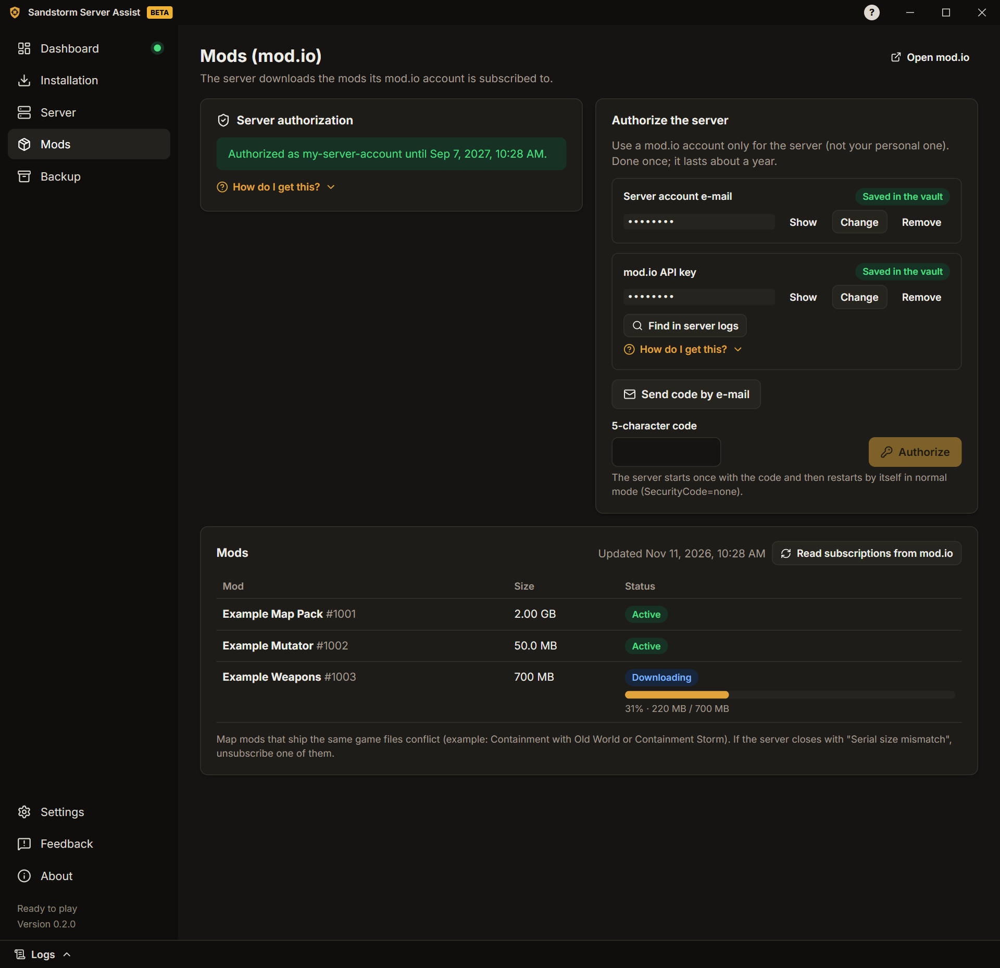

# Посібник користувача

[English](../GUIDE.md) · [Português](../pt-PT/GUIDE.md) · [Español](../es-ES/GUIDE.md) · [Русский](../ru/GUIDE.md) · **Українська**

> Переклад [посібника англійською](../GUIDE.md). Якщо є розбіжності, правильна англійська версія.

Цей посібник проведе вас від нуля до працюючого сервера Insurgency: Sandstorm з модами. На кожному екрані
застосунку також є короткі підказки та інструкції «Як отримати?».

## 1. Встановлення застосунку

1. Завантажте інсталятор (`…-windows-setup.exe`) на
   [сторінці релізів](https://github.com/felipesulzbach/sandstorm-server-assist/releases/latest).
2. Запустіть його. Він встановлюється для вашого користувача Windows і не потребує прав адміністратора. Якщо
   SmartScreen попереджає, натисніть **Докладніше** › **Однаково запустити**.
3. Відкрийте застосунок, виберіть мову й прийміть умови використання та повідомлення про конфіденційність
   (**Прийняти і продовжити**).

Застосунок сам перевіряє нові версії та встановлює лише оновлення, підписані проєктом.

## 2. Встановлення сервера

1. Відкрийте **Встановлення** і виберіть **Тека сервера**. Потрібно близько 25 ГБ вільного місця плюс моди. Не
   використовуйте системні теки, як-от `C:\Program Files`.
2. Натисніть **Завантажити SteamCMD**. Застосунок перевіряє цифровий підпис Valve перед запуском. Після завантаження кнопка називається **Перевірити SteamCMD**: SteamCMD оновлюється сам щоразу, коли застосунок його запускає.
3. Натисніть **Встановити сервер** і стежте за прогресом. Пізніше **Перевірити оновлення** оновить його, а
   **Перевірити файли** виправить пошкоджене встановлення.

**Сервер уже є?** Виберіть його теку. Застосунок прочитає налаштування останнього запуску (з журналу й файлів
конфігурації) і заповнить поля. Якщо значення в застосунку відрізняється від сервера, він запитає, яке залишити.

## 3. Налаштування сервера

Відкрийте **Сервер**. Вкладки:

- **Загальні:** назва сервера, максимум гравців і порти.
- **Мапи:** стартова мапа, мапа з мода (мапа, яку сервер відкриває після завантаження модів), ротація мап, день чи
  ніч і мутатори (застосунок знаходить мутатори встановлених модів).
  Якщо сервер відхилить мутатор, панель і цей список покажуть який.
- **Правила гри:** боти й складність, таймери, вогонь по своїх, чат і голос, голосування та інше. Залиште вимкненим,
  щоб не змінювати файли.
  Якщо на сервері вже задано правила, вкладка запропонує **Узяти правила сервера**.
- **Адміністратори:** SteamID64 кожного адміністратора (у підказці показано, як його знайти).
- **Паролі й токени:** пароль для входу, пароль RCON, токен ігрового сервера Steam (GSLT) і токен GameStats. Вони
  зберігаються в сховищі, зашифрованому Windows, а не у файлах сервера.
- **Мережа:** порти, IP для гравців, правило брандмауера й діагностика портів (розділ 5).
- **Повідомлення:** повідомлення дня (екран завантаження) і повідомлення в чаті, коли гравець входить чи виходить.
- **Автоматизація:** повідомлення за розкладом, щоденний перезапуск, перезапуск після збою та сповіщення в Discord.

Натисніть **Зберегти** після змін на вкладці.

## 4. Додавання модів

Сервер завантажує моди, на які підписаний його обліковий запис mod.io.

1. Відкрийте **Моди**. Використовуйте обліковий запис mod.io лише для сервера, а не особистий. Введіть його e-mail і
   API-ключ mod.io (**Знайти в журналах сервера** або створіть ключ за підказкою). Натисніть
   **Надіслати код на e-mail**.
2. Введіть код із 5 символів і натисніть **Авторизувати**. Сервер авторизується один раз; застосунок сам повернеться
   до звичайного режиму.
3. Підпишіться на моди на [сайті mod.io](https://mod.io/g/insurgencysandstorm) з цим обліковим записом. У списку видно
   кожен мод і його завантаження під час запуску сервера.
   Ще не завантажені моди показані над списком: **Завантажити зараз** запускає сервер (або, запитавши, перезапускає
   його), щоб він їх завантажив.

Щоб починати на мапі з мода, виберіть її в **Сервер › Мапи** (**Назва мапи з мода** і **Сценарій мапи з мода**).

Мод пошкоджений або потрібна свіжа копія? Натисніть кошик поруч із ним. **Видалити й завантажити знову** сам
зупинить і запустить сервер; **Лише видалити** (сервер зупинено) залишає завантаження до наступного запуску.

## 5. Відкриття портів

Гравці з інтернету підключаються до сервера через два порти **UDP**: **ігровий порт** і **порт запитів** (їх
показано в **Сервер › Мережа**).

1. На сторінці роутера перенаправте обидва порти (UDP) на цей ПК. Якщо ви граєте через VPN-програму, пропустіть цей
   крок і повідомте адресу VPN.
2. У **Сервер › Мережа** натисніть **Створити правило брандмауера**. Windows запитає підтвердження адміністратора.
3. **Ніколи не перенаправляйте порт RCON.** Він має бути закритий для інтернету.

Потім натисніть **Діагностика портів**, краще із запущеним сервером. Застосунок перевіряє з цього ПК:

- чи відповідає сервер на порту запитів;
- правила брандмауера Windows;
- перенаправлення портів у роутері (якщо роутер дозволяє UPnP);
- ваш публічний IP і чи використовує провайдер CGNAT (тоді перенаправлення портів не працюватиме);
- чи відповідає сервер через ваш публічний IP і чи бачить його Steam.

### Перевірка з другом

ПК не може довести, що його власні порти відкриті з інтернету. Коли сервер запущено, попросіть друга з іншої мережі:

1. Відкрити Steam › **Вигляд** › **Ігрові сервери** › **Обране**.
2. Натиснути **Додати сервер** (+), ввести `ваш-публічний-IP:порт-запитів` і натиснути
   **Знайти ігри за цією адресою**.
3. Якщо сервер з'явився з назвою та мапою, порти відкриті.

Поради: не перевіряйте з ПК у вашій мережі (більшість роутерів це блокують); мобільний інтернет вважається іншою
мережею; сайти «перевірки портів» зазвичай перевіряють лише TCP, а гра використовує UDP.

## 6. Запуск сервера

1. Відкрийте **Панель** і натисніть **Запустити сервер**.
2. Стежте за етапами: процес запущено, mod.io підключено, моди активовано, мапу завантажено, готовий до гри.
3. Надішліть гравцям команду для входу, показану на Панелі.

Ігровий сервер продовжує працювати, якщо закрити застосунок. Коли ви знову відкриєте застосунок, він знайде сервер і
продовжить стежити за ним.

Поки сервер працює, можна **змінити мапу**, відкрити **панель гравців** (кік, бан, повідомлення всім) і читати
**Журнали** (висувна панель унизу; паролі й токени приховані).

## 7. Резервна копія

Відкрийте **Резервна копія**, щоб створити один файл, захищений паролем, із вашими налаштуваннями, секретами й
файлами конфігурації сервера. З його допомогою можна перенести сервер на інший ПК: там натисніть **Відкрити копію**,
введіть пароль і виберіть теку сервера. Без пароля копію відкрити не можна.

## 8. Проблеми та зворотний зв'язок

- Кожна відома помилка показує, **що сталося**, **можливу причину** і **як виправити**.
- Відкрийте панель **Журнали**, щоб бачити, що робить сервер.
- **Моди › Проблемні моди** показує моди з однаковими файлами гри в різних версіях і знаходить мод за
  повідомленням про помилку: вставте помилку, яку отримав гравець (наприклад, «Serial size mismatch»), і застосунок
  назве мод.

Щоб повідомити про проблему або запропонувати покращення, відкрийте **Зворотний зв'язок**:

1. Виберіть **Повідомити про проблему** або **Запропонувати покращення**.
2. За бажанням введіть заголовок і опис, залиште позначеним **Додати журнал застосунку** і додайте знімок екрана (до
   5 МБ).
3. Натисніть **Підготувати й відкрити GitHub**. Застосунок збереже `.zip` на ПК і відкриє вже заповнену форму GitHub.
4. Перетягніть `.zip` у форму й натисніть **Create**. Потрібен безкоштовний обліковий запис GitHub.

Застосунок сам нічого не надсилає. У журналі паролі, токени, IP-адреси та SteamID приховані.
